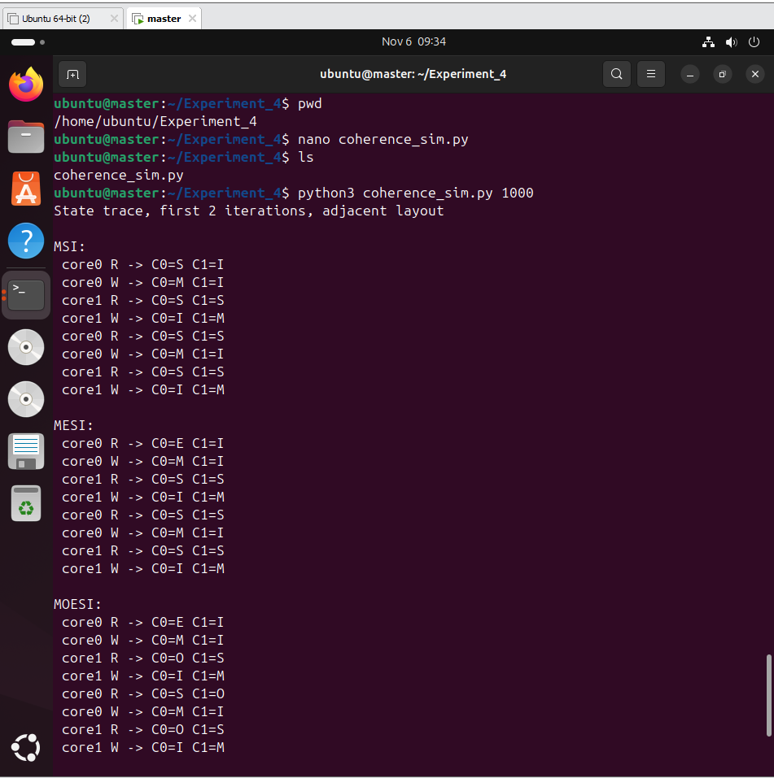
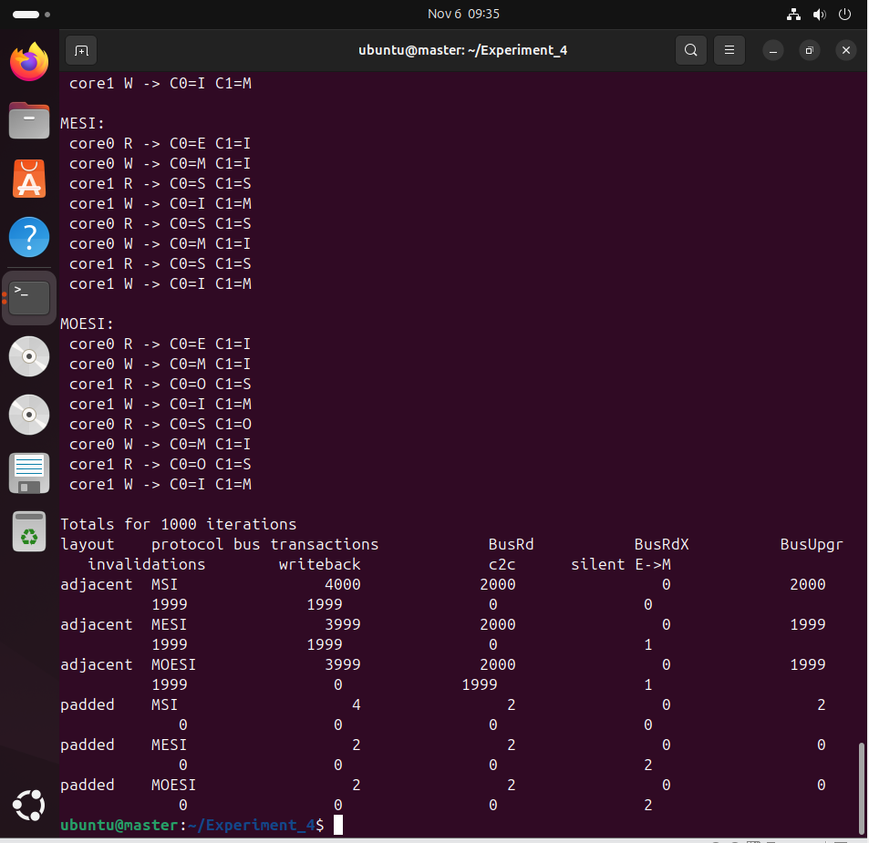
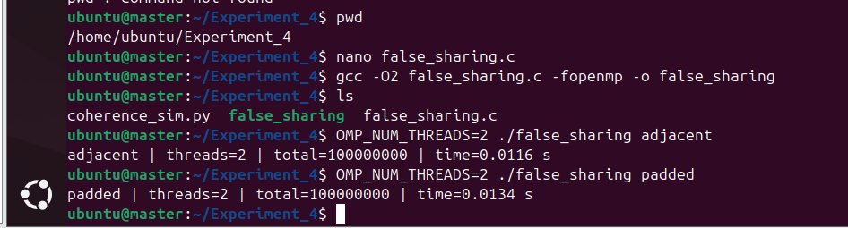
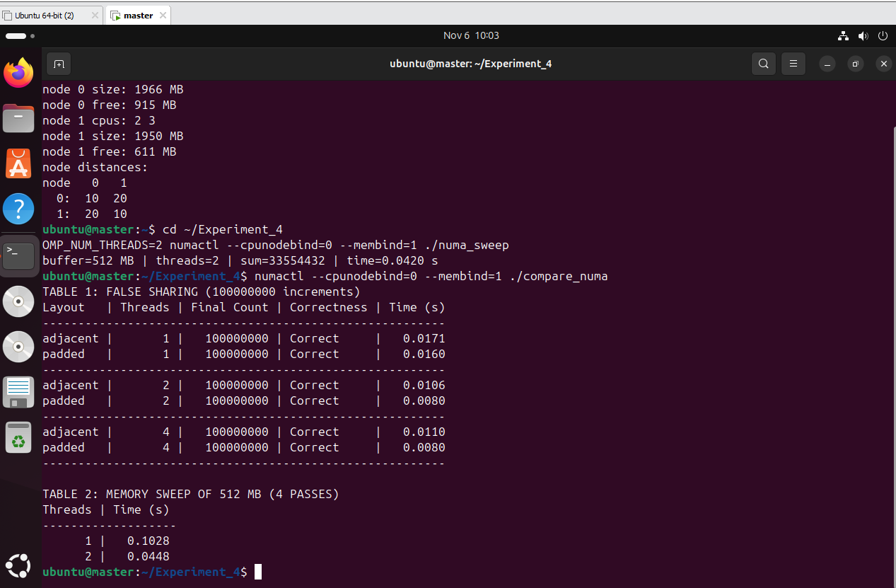
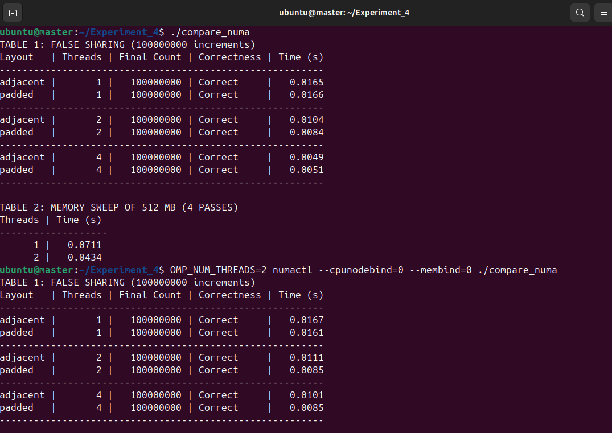
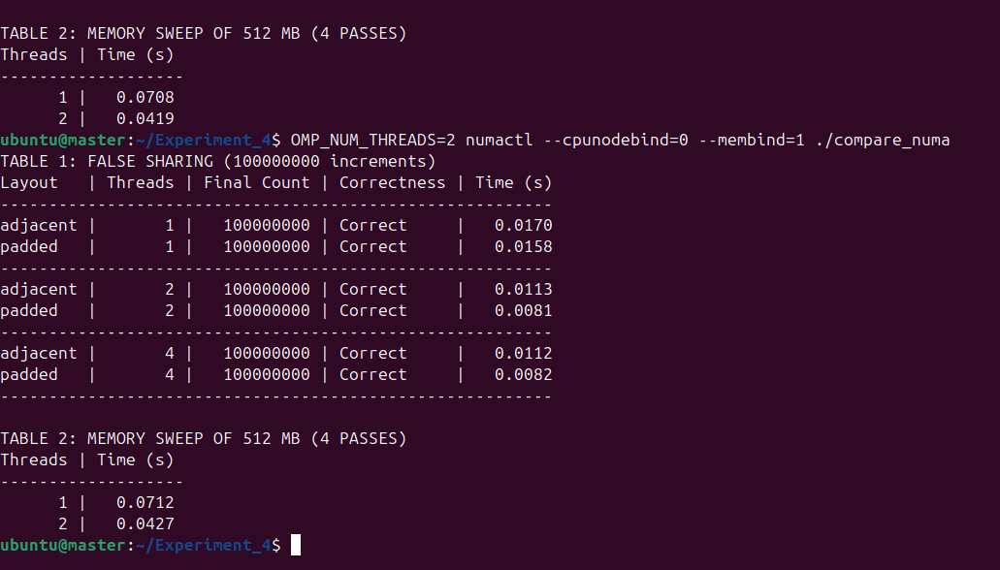

# Experiment 4: Analysis of Cache Coherence Protocols and NUMA Memory Access Performance

## 1. Overview

This experiment investigates cache coherence mechanisms and memory access performance in parallel computing systems. It focuses on MSI, MESI, and MOESI cache coherence protocols, false sharing in shared-memory programs, and local versus remote NUMA memory access.

The programs were implemented using C, Python, OpenMP, GCC, and NUMA utilities on Ubuntu 24.04.4 LTS running in VMware.

## 2. Objectives

- Study cache coherence protocols MSI, MESI, and MOESI.
- Simulate cache-state transitions.
- Demonstrate false sharing using adjacent and padded counters.
- Configure and identify multiple NUMA nodes.
- Compare local and remote memory access performance.
- Measure execution times using different OpenMP thread counts.

## 3. Environment

| Component | Configuration |
|---|---|
| Operating System | Ubuntu 24.04.4 LTS |
| Virtualization | VMware Workstation |
| Programming Languages | C and Python |
| Compiler | GCC |
| Parallel Framework | OpenMP |
| NUMA Utility | numactl |
| Virtual CPUs | 4 |
| RAM | 4096 MB |
| NUMA Nodes | 2 |

### NUMA Node Configuration

| Node | CPUs |
|---|---|
| Node 0 | 0, 1 |
| Node 1 | 2, 3 |

## 4. Theory

### 4.1 Cache Coherence

Cache coherence ensures that multiple processors accessing shared memory maintain consistent cached copies of data.

### 4.2 MSI Protocol

MSI contains three states:

- Modified (M)
- Shared (S)
- Invalid (I)

### 4.3 MESI Protocol

MESI extends MSI with an Exclusive (E) state, allowing a cache to modify an exclusively held clean line without an additional coherence transaction.

States: Modified, Exclusive, Shared, Invalid.

### 4.4 MOESI Protocol

MOESI extends MESI with an Owned (O) state. An Owned cache can provide modified shared data to another cache without immediately writing it back to main memory.

States: Modified, Owned, Exclusive, Shared, Invalid.

### 4.5 False Sharing

False sharing occurs when different threads update different variables located on the same cache line. This can cause unnecessary cache coherence traffic. Padding separates the variables into different cache lines.

### 4.6 NUMA Architecture

NUMA means Non-Uniform Memory Access. Local memory access is generally faster than remote memory access because remote access involves another NUMA node.

## 5. Experimental Implementation

### Part A: Cache Coherence Simulation

The Python program `coherence_sim.py` simulates MSI, MESI, and MOESI using two processor cores.

It compares adjacent and padded layouts and records cache-state transitions and coherence transactions.

**Execution:**

```bash
python3 coherence_sim.py 1000
```

The simulation demonstrates that adjacent memory layouts can generate significantly more coherence activity than padded layouts.

**Evidence:**



### Part B: False Sharing

The C program `false_sharing.c` uses OpenMP to compare adjacent and padded counters.

**Compilation:**

```bash
gcc -O2 false_sharing.c -fopenmp -o false_sharing
```

**Execution:**

```bash
OMP_NUM_THREADS=2 ./false_sharing adjacent
OMP_NUM_THREADS=2 ./false_sharing padded
```

**Actual results:**

| Layout | Threads | Final Count | Time (s) |
|---|---:|---:|---:|
| Adjacent | 2 | 100000000 | 0.0116 |
| Padded | 2 | 100000000 | 0.0134 |

Both layouts produced the correct final count. In this individual run, the padded version was slightly slower. Timing can vary with scheduling, virtualization, and system load.

**Evidence:**



### Part C: NUMA Memory Access

The program `numa_sweep.c` allocates a 512 MB buffer and performs four passes using OpenMP.

**Compilation:**

```bash
gcc -O2 numa_sweep.c -fopenmp -o numa_sweep
```

**Check NUMA hardware:**

```bash
numactl --hardware
```

The virtual machine exposed two NUMA nodes.

| Source Node | Node 0 | Node 1 |
|---|---:|---:|
| Node 0 | 10 | 20 |
| Node 1 | 20 | 10 |

**Normal execution:**

```bash
OMP_NUM_THREADS=2 ./numa_sweep
```

**Local execution:**

```bash
OMP_NUM_THREADS=2 numactl --cpunodebind=0 --membind=0 ./numa_sweep
```

**Remote execution:**

```bash
OMP_NUM_THREADS=2 numactl --cpunodebind=0 --membind=1 ./numa_sweep
```

**Recorded remote memory sweep:**

| Buffer | Threads | Sum | Time (s) |
|---|---:|---:|---:|
| 512 MB | 2 | 33554432 | 0.0420 |

**Evidence:**



### Part D: Combined Performance Comparison

The program `compare_numa.c` compares adjacent and padded layouts with 1, 2, and 4 threads. It also measures a 512 MB memory sweep.

**Compilation:**

```bash
gcc -O2 compare_numa.c -fopenmp -o compare_numa
```

#### D.1 Normal Execution

```bash
./compare_numa
```

| Layout | Threads | Final Count | Correctness | Time (s) |
|---|---:|---:|---|---:|
| Adjacent | 1 | 100000000 | Correct | 0.0165 |
| Padded | 1 | 100000000 | Correct | 0.0166 |
| Adjacent | 2 | 100000000 | Correct | 0.0104 |
| Padded | 2 | 100000000 | Correct | 0.0084 |
| Adjacent | 4 | 100000000 | Correct | 0.0049 |
| Padded | 4 | 100000000 | Correct | 0.0051 |

Memory sweep:

| Threads | Time (s) |
|---|---:|
| 1 | 0.0711 |
| 2 | 0.0434 |

#### D.2 Local NUMA Execution

```bash
OMP_NUM_THREADS=2 numactl --cpunodebind=0 --membind=0 ./compare_numa
```

| Layout | Threads | Final Count | Correctness | Time (s) |
|---|---:|---:|---|---:|
| Adjacent | 1 | 100000000 | Correct | 0.0167 |
| Padded | 1 | 100000000 | Correct | 0.0161 |
| Adjacent | 2 | 100000000 | Correct | 0.0111 |
| Padded | 2 | 100000000 | Correct | 0.0085 |
| Adjacent | 4 | 100000000 | Correct | 0.0101 |
| Padded | 4 | 100000000 | Correct | 0.0085 |

Memory sweep:

| Threads | Time (s) |
|---|---:|
| 1 | 0.0708 |
| 2 | 0.0419 |

#### D.3 Remote NUMA Execution

```bash
OMP_NUM_THREADS=2 numactl --cpunodebind=0 --membind=1 ./compare_numa
```

| Layout | Threads | Final Count | Correctness | Time (s) |
|---|---:|---:|---|---:|
| Adjacent | 1 | 100000000 | Correct | 0.0170 |
| Padded | 1 | 100000000 | Correct | 0.0158 |
| Adjacent | 2 | 100000000 | Correct | 0.0113 |
| Padded | 2 | 100000000 | Correct | 0.0081 |
| Adjacent | 4 | 100000000 | Correct | 0.0112 |
| Padded | 4 | 100000000 | Correct | 0.0082 |

Memory sweep:

| Threads | Time (s) |
|---|---:|
| 1 | 0.0712 |
| 2 | 0.0427 |

**Evidence:**







## 6. Results

- The cache coherence simulation demonstrates the effect of memory layout on coherence transactions.
- All counter tests returned the correct final count of 100,000,000.
- The normal two-thread combined test recorded 0.0104 seconds for adjacent and 0.0084 seconds for padded counters.
- The two-thread memory sweep was faster than the one-thread sweep in normal, local, and remote configurations.
- The VM exposed two NUMA nodes, with local distance 10 and remote distance 20.
- Local and remote timings were close, so this virtualized experiment did not demonstrate a large remote memory access penalty.

## 7. Conclusion

The experiment successfully demonstrated MSI, MESI, and MOESI cache coherence protocols, false sharing, and NUMA memory access performance.

The simulation illustrated how cache-line sharing can increase coherence activity. The OpenMP experiments compared adjacent and padded counters, while the NUMA experiments successfully tested normal, local, and remote memory placement.

The practical provided an understanding of cache coherence, false sharing, parallel execution, and NUMA memory placement.
